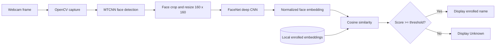

# FACIAL RECOGNITION SYSTEM USING DEEP LEARNING

## A Mini Project Report

Submitted in partial fulfilment of the requirements for the award of the degree of Bachelor of Technology in Computer Science and Engineering.

**Submitted by:** [Student 1 - Roll No.], [Student 2 - Roll No.], [Student 3 - Roll No.]  
**Faculty coordinator:** [Name and designation]  
**Department:** Computer Science and Engineering  
**Month, Year:** [Month, Year]

## Certificate

This is to certify that the mini project entitled *Facial Recognition System Using Deep Learning* is submitted by the above students in partial fulfilment of the requirement for the Bachelor of Technology degree. The work was carried out under the supervision of [Supervisor Name] and has not been submitted elsewhere for another degree or diploma.

## Declaration

We declare that this mini project is our original work completed under the guidance of [Supervisor Name]. Any ideas, code, or publications used from other sources are acknowledged in the references.

## Acknowledgement

We sincerely thank our department, faculty coordinator, project supervisor, and classmates for their guidance and support during this project.

## Abstract

This project implements a local, consent-based facial recognition prototype using deep learning. A webcam frame is acquired through OpenCV, MTCNN detects face regions, and a pre-trained FaceNet model converts each face into a compact numerical embedding. During enrollment, embeddings from several images of a consenting participant are averaged and stored locally. During recognition, the live embedding is compared with the stored embeddings using cosine similarity. If the best score is above a configurable threshold, the system displays the corresponding label; otherwise it reports Unknown. The project demonstrates real-time computer vision while retaining an explicit Unknown outcome and avoiding unsupported claims that the result proves a person's identity. Performance is evaluated using precision, recall, F1-score, confusion matrix, and FPS after consented test data are collected.

# 1. Introduction

## 1.1 Background

Face recognition is a biometric computer-vision task that determines whether a detected face is sufficiently similar to enrolled reference faces. Traditional approaches rely on manually designed features and can struggle with illumination changes, pose, expression, and partial occlusion. Deep neural networks learn features from images automatically. In this project, the learned feature is a FaceNet embedding, a vector intended to place similar faces near each other in feature space.

## 1.2 Motivation

A face-recognition demonstration is a useful way to study the complete machine-learning pipeline: data capture, detection, feature extraction, comparison, threshold selection, testing, and limitations. A pre-trained approach makes this achievable as a mini project without a large custom dataset or a high-end GPU.

## 1.3 Scope

The system supports local webcam enrollment and recognition for people who consent to participate. It detects faces, generates embeddings, stores local reference vectors, and labels an accepted match or Unknown. It is not an access-control system, surveillance deployment, or liveness-detection solution.

## 1.4 Organization

The report reviews related work, defines the problem and objectives, explains the design and implementation, proposes tests and metrics, then discusses limitations and future work.

# 2. Literature Review

| Work | Main contribution | Relevance / limitation |
|---|---|---|
| FaceNet - Schroff et al. (2015) | Learns an embedding where distance represents facial similarity. | Supports fast comparison; training from scratch needs substantial data and compute. |
| Deep Residual Learning - He et al. (2016) | Uses residual connections to train deep image networks. | Important foundation for deep visual feature extractors. |
| MTCNN - Zhang et al. (2016) | Jointly detects faces and facial landmarks with cascaded CNNs. | Helps isolate faces before embedding; may still degrade in extreme conditions. |

# 3. Problem Statement and Objectives

## 3.1 Problem Statement

Develop a local real-time system that detects a face in a webcam stream, represents it with a deep-learning embedding, compares it with a consented enrollment database, and returns a label only when a configurable similarity threshold is met.

## 3.2 Objectives

- Capture and process live webcam frames.
- Detect face locations using MTCNN.
- Extract a normalized FaceNet embedding from each detected face.
- Enroll multiple samples per person and match live embeddings to saved identities.
- Display Unknown for a low-confidence match.
- Measure precision, recall, F1-score, confusion matrix, and FPS using a consented test set.

# 4. System Analysis and Design

## 4.1 Requirements

| Hardware | Software |
|---|---|
| Laptop/desktop, webcam, 8 GB RAM recommended | Python 3.10+, TensorFlow, MTCNN, Keras-FaceNet, OpenCV, NumPy, scikit-learn |

## 4.2 Architecture

## 4.3 Data Flow

During enrollment, the user enters a label, captures multiple acceptable frames, and the system saves one averaged embedding for that label in `data/embeddings.npz`. During recognition, no image is stored by default; the live embedding is compared to these saved vectors for the current session.

# 5. Implementation

## 5.1 Technology Stack

- **Python:** application logic and command-line interface.
- **OpenCV:** webcam input, BGR/RGB conversion, face rectangles, labels, and FPS display.
- **MTCNN:** face detector that returns a bounding box, confidence, and landmarks.
- **TensorFlow and Keras-FaceNet:** execution of the pre-trained FaceNet embedding network.
- **NumPy:** L2 normalization, averaging enrollment samples, and cosine-similarity calculation.
- **scikit-learn:** optional evaluation metrics.

## 5.2 Modules

| File | Responsibility |
|---|---|
| `face_pipeline.py` | Shared detection, cropping, embedding, local storage, and matching functions. |
| `enroll.py` | Captures a consenting person's face samples and saves the average embedding. |
| `recognize.py` | Reads the webcam and labels detected faces in real time. |
| `evaluate.py` | Calculates a classification report and confusion matrix from labelled test outcomes. |

## 5.3 Core Algorithm

1. Read a frame from the webcam.
2. Convert its OpenCV BGR colour order to RGB and use MTCNN to find face boxes.
3. Crop each valid box and resize it to 160 x 160 pixels.
4. Send the crop to FaceNet to obtain an embedding, then L2-normalize it.
5. Calculate the dot product between the normalized live vector and each normalized saved vector. This is cosine similarity.
6. Choose the highest score. If it is at least the chosen threshold (default 0.72), display its name; otherwise display Unknown.

For normalized vectors `q` and `e`, cosine similarity is:

`similarity(q, e) = q . e`

The score is useful for thresholding, but it is not a probability and must not be presented as proof of identity.

# 6. Testing

## 6.1 Strategy

Use separate enrollment and test images so the evaluation does not simply repeat the same frames. Obtain consent from every participant. Test normal lighting, low lighting, moderate side pose, glasses, an empty frame, and a person who was not enrolled. Measure the time required to process frames to calculate FPS.

## 6.2 Test Case Template

| Test case | Expected result | Actual result | Status |
|---|---|---|---|
| Enrolled participant, normal lighting | Correct label if score passes threshold | [Record after test] | [Pass/Fail] |
| Unenrolled participant | Unknown | [Record after test] | [Pass/Fail] |
| No face in frame | No label and no crash | [Record after test] | [Pass/Fail] |
| Low light or side pose | Result or Unknown without a false confident claim | [Record after test] | [Pass/Fail] |

Run `python evaluate.py sample_results.csv` after replacing the sample CSV with actual held-out outcomes. Precision, recall, and F1 should be reported only from these recorded results.

# 7. Results and Discussion

Do not fill this section until test runs are completed. Report the computer specification, number of enrolled people, number of held-out trials per condition, threshold value, precision, recall, macro F1-score, confusion matrix, and average FPS. Discuss false accepts and false rejects separately. The threshold involves a trade-off: increasing it reduces mistaken matches but produces more Unknown results.

# 8. Conclusion and Future Scope

## 8.1 Conclusion

The implemented prototype demonstrates the full deep-learning facial recognition pipeline: webcam capture, MTCNN detection, FaceNet embedding generation, local embedding storage, cosine-similarity matching, and an Unknown decision. It is suitable for an educational, consent-based demonstration. Its output must be treated as a similarity result rather than a definitive identity decision.

## 8.2 Future Scope

- Add liveness or anti-spoofing detection before any authentication use.
- Calibrate thresholds on a representative, consented validation set.
- Encrypt stored embedding data and add secure deletion/retention policies.
- Improve alignment and robustness for pose, lighting, occlusion, and diverse participants.
- Explore lightweight, quantized models for edge devices.

# References

1. F. Schroff, D. Kalenichenko, and J. Philbin, "FaceNet: A Unified Embedding for Face Recognition and Clustering," CVPR, 2015.
2. K. He, X. Zhang, S. Ren, and J. Sun, "Deep Residual Learning for Image Recognition," CVPR, 2016.
3. K. Zhang, Z. Zhang, Z. Li, and Y. Qiao, "Joint Face Detection and Alignment Using Multitask Cascaded Convolutional Networks," IEEE Signal Processing Letters, 2016.
